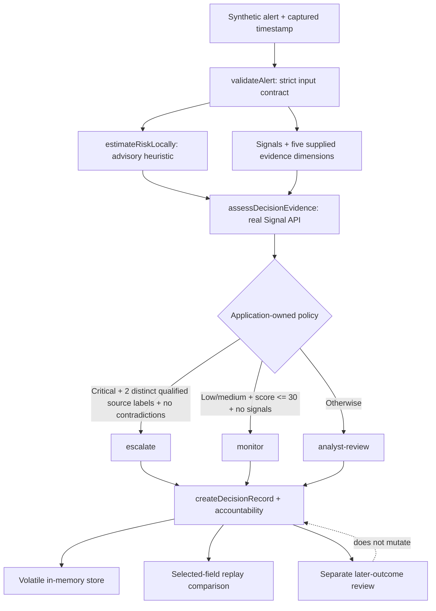

# Repository-first course lab — Build AI Decision Systems with Signal

> **Status:** teaching example, not a production security system. This lab uses the checked-in TypeScript application and the real `@signal/decision/core` APIs. It does not substitute a companion implementation for Signal.

## Teaching contract

This is a **repository-first, compiling-checkpoint walkthrough**, not a from-zero file-construction exercise. The complete canonical implementation is present from the start. Each checkpoint inspects one bounded region of that implementation, checks a corresponding behavior, and runs verification against the complete project. Do not delete later declarations or append partial fragments to the canonical source: a partially assembled TypeScript file is not a valid checkpoint.

- Canonical implementation: `examples/ai-decision-system/src/index.ts`
- Canonical tests: `examples/ai-decision-system/test/triage.test.ts`
- Real Signal API: `@signal/decision/core`
- Baseline branch at the time of the course release: `course/repository-first-decision-system`, commit `3c9e122484ab7134eddf51452503afdb1fc0a4a4`
- Current baseline: 10 top-level tests; the five evidence dimensions are exercised by one parameterized loop.

## The engineering contract

**Input:** a validated synthetic security alert and an explicit capture timestamp.

**Output:** a triage recommendation (`escalate`, `analyst-review`, or `monitor`), rationale, Signal evidence assessment, and reviewable Signal decision record.

**Boundaries:** no trained ML model, provider calls, automated security response, durable audit log, or tamper-proof replay. The local heuristic is advisory. Distinct source labels and independence scores are supplied claims; this example does not independently verify real-world source independence.

## Architecture at a glance



**Key distinction:** Signal assesses and records evidence; application policy chooses the triage priority. The local heuristic score cannot independently trigger escalation.

## Start from a clean checkout

Use Node.js 20+ and pnpm 10.12.4. Run from the Signal repository root:

```bash
node --version
corepack pnpm --version
corepack pnpm install --filter @signal/ai-decision-system --filter '!signal-workspace' --frozen-lockfile
corepack pnpm --filter @signal/ai-decision-system build
corepack pnpm --filter @signal/ai-decision-system test
corepack pnpm --filter @signal/ai-decision-system typecheck
corepack pnpm --filter @signal/ai-decision-system start
```

The commands above are instructions, not evidence of success. Save actual output during recording. If a command fails, stop and diagnose it rather than narrating a pass.

Expected baseline fixture outcomes to compare with real terminal output:

| Fixture | Advisory estimate | Priority |
| --- | ---: | --- |
| `confirmed-critical` | 100/100 | `escalate` |
| `high-score-unconfirmed` | 94/100 | `analyst-review` |
| `low-background` | 14/100 | `monitor` |

## Eight individually verifiable compiling checkpoints

**Checkpoint protocol:** at each checkpoint, keep the full source tree intact, inspect the indicated code and test, then run the listed command(s). The `build` command compiles the application; `test` compiles the test TypeScript before running it. These are verified states of the complete project, not claims that a fragment can compile on its own. Run `typecheck` at each checkpoint if the environment permits; the final gate must include all checks plus fixture execution.

### 1. Define the decision-time boundary — slides 1–6

**Inspect:** `Severity`, `EvidenceDirection`, `TriagePriority`, `AlertSignal`, `SecurityAlert`, `DecisionTimeSnapshot`, and `EvaluatedDecision` near the top of `src/index.ts`.

**Verify:** the snapshot captures the alert, timestamp, and versioned estimator but has no later-outcome field. Confirm the five evidence dimensions are explicit inputs.

**Checkpoint command:**

```bash
corepack pnpm --filter @signal/ai-decision-system build
```

**Exit condition:** compilation succeeds and the types make the decision-time boundary inspectable.

### 2. Validate before reasoning — slides 7–10

**Inspect:** `validateAlert`, `requiredTimestamp`, `boundedScore`, and the validation test in `test/triage.test.ts`.

**Demonstrate:** invalid severity, NaN/out-of-range scores, an impossible date such as `2025-02-30T09:14:00Z`, and duplicate signal IDs.

**Checkpoint command:**

```bash
corepack pnpm --filter @signal/ai-decision-system test
```

**Exit condition:** the validation test passes; malformed inputs are rejected rather than silently defaulted.

### 3. Keep the heuristic advisory — slides 11–12

**Inspect:** `SEVERITY_BASE`, `estimateRiskLocally`, and the `high-score-unconfirmed` fixture.

**Verify:** the deterministic estimate is not described as a trained model or calibrated probability. A score of 94/100 with no telemetry remains `analyst-review`.

**Checkpoint command:**

```bash
corepack pnpm --filter @signal/ai-decision-system test
```

**Exit condition:** the high-score regression passes; score alone cannot escalate.

### 4. Call Signal's actual evidence API — slides 13–14

**Inspect:** the `DecisionEvidence` mapping and `assessDecisionEvidence` call inside `evaluateAlert`.

**Verify:** signal direction and five quality dimensions are preserved; the heuristic is mapped as neutral evidence; knowns, unknowns, assumptions, contradictions, and journal references are recorded.

**Checkpoint command:**

```bash
corepack pnpm --filter @signal/ai-decision-system build
```

**Exit condition:** the actual `@signal/decision/core` types compile without a substitute/mock Signal implementation.

### 5. Apply explicit policy gates — slides 15–18

**Inspect:** `TRIAGE_RULES`, `meetsStrongEvidenceThresholds`, `canEscalate`, `canMonitor`, and `buildRationale`.

**Verify:** escalation requires critical severity, two distinct qualified source labels, and no contradiction. Every supporting source must pass quality >=70, reliability >=70, freshness >=60, independence >=70, and traceability >=60. A failed dimension disqualifies that source.

**Checkpoint command:**

```bash
corepack pnpm --filter @signal/ai-decision-system test
```

**Exit condition:** duplicate source labels do not count twice, all five dimension regressions withhold escalation, contradictions block escalation, and a high score alone cannot escalate.

### 6. Record rationale and accountability — slide 19

**Inspect:** `createDecisionRecord`, `createAccountabilityReport`, `attachAccountability`, `createExampleStore`, and `storeDecision`.

**Verify:** the rationale is carried into the record, journal evidence IDs correspond to captured evidence, and `accountability.actionTaken` is false.

**Checkpoint command:**

```bash
corepack pnpm --filter @signal/ai-decision-system test
```

**Exit condition:** the record/accountability test passes. Do not call the in-memory store durable, immutable, or tamper-proof.

### 7. Replay only what is defined — slides 20–22

**Inspect:** `replayCapturedDecision` and its test.

**Verify:** replay re-evaluates the captured alert and timestamp, compares selected application fields, and calls Signal's `replayDecision` for coherence comparison. It does not prove tamper resistance, replay side effects, or verify a runtime audit history.

**Checkpoint command:**

```bash
corepack pnpm --filter @signal/ai-decision-system test
```

**Exit condition:** unchanged captured inputs produce the expected `same-result` and Signal `same-decision` results.

### 8. Keep later outcomes separate; run the release gate — slides 23–27

**Inspect:** `reviewLaterOutcome`, `reviewDecisionOutcome`, the outcome-separation test, and the test catalogue.

**Verify:** later outcome review does not rewrite the original record or become an input to replay/estimation. The current suite has 10 top-level test definitions.

**Checkpoint commands:**

```bash
corepack pnpm --filter @signal/ai-decision-system build
corepack pnpm --filter @signal/ai-decision-system test
corepack pnpm --filter @signal/ai-decision-system typecheck
corepack pnpm --filter @signal/ai-decision-system start
```

**Exit condition:** all four commands succeed in the recording environment and actual fixture output matches the expected table above.

## Independent challenge — change the actual policy test-first

**Goal:** demonstrate a stricter escalation rule that requires three qualified source labels instead of two. This is a teaching policy change, not a universal security recommendation.

1. Add a test to `test/triage.test.ts` for a two-source copy of `EXAMPLE_ALERTS[0]`; expect `analyst-review` and rationale stating that three qualified sources are required.
2. Run `corepack pnpm --filter @signal/ai-decision-system test`. The new assertion should fail under the current two-source rule. Capture the real output.
3. Change `minimumStrongSourcesToEscalate` from `2` to `3` in `src/index.ts` and rerun tests.
4. Resolve the existing fixture contract conflict deliberately. The canonical confirmed fixture must contain three distinct qualified synthetic source labels for escalation under the new rule. Update the five-dimension regression expectation to reflect that degrading one of three sources leaves two qualified sources, still below the threshold.
5. Keep the duplicate-source test and contradiction test meaningful. Do not delete an existing assertion merely to get green.
6. Run build, test, typecheck, and start. This optional exercise solution is not covered by the baseline CI run until it is executed on the changed source.

**Instructor answer key:** see `POLICY_EXERCISE_SOLUTION.md` on the separate solution branch. Do not merge the three-source solution into the baseline release without synchronizing the slides and narration.

The supplied `source` labels and independence scores do not establish actual organizational or technical independence. Explain that limitation aloud.

## Source-of-truth map

| Slides | Implementation | Verification |
| --- | --- | --- |
| 1–6 | Types and `DecisionTimeSnapshot` | Build checkpoint |
| 7–10 | `validateAlert` and timestamp helpers | Validation test |
| 11–12 | `estimateRiskLocally` | High score remains advisory |
| 13–14 | `assessDecisionEvidence` mapping | Build and evidence assertions |
| 15–18 | `TRIAGE_RULES` and `buildRationale` | Source, dimension, contradiction tests |
| 19 | Decision record and accountability | Record consistency test |
| 20–22 | `replayCapturedDecision` | Replay test |
| 23–27 | Later outcome review and course close | Outcome test + full release gate |

## Verification boundaries

- The focused course workflow passed on commit `3c9e122484ab7134eddf51452503afdb1fc0a4a4`: frozen-lockfile install, build, 10 tests, typecheck, and fixture execution succeeded.
- Separate Signal core workflow run #101 failed in `@signal/runtime` because Vite could not resolve `@signal/runtime` and `@signal/protocol` package entrypoints before test collection. Do not claim the entire repository is green.
- The optional three-source exercise has not been executed in the cited baseline CI run.
- The example uses synthetic fixtures, a deterministic heuristic, volatile in-memory storage, and selected-field replay. It is not a production security control.